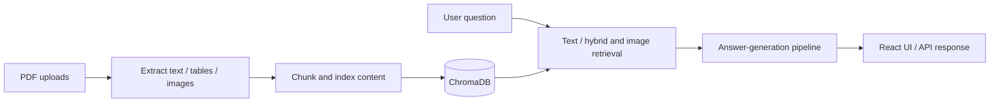

# Multimodal RAG System

**PDF-based retrieval and question answering with text, tables, and image-aware components.**

This repository contains document ingestion, text and image retrieval, a FastAPI service, a React frontend, and a command-line workflow. It is a practical exploration of how to retrieve evidence from PDF collections before constructing answers.

> **Project status:** Research / engineering prototype. The checked-in source includes retrieval and answer-generation components, but this README does not claim independently benchmarked accuracy, guaranteed source grounding, or production deployment readiness.

## System design



## Repository guide

| Path | Responsibility |
| --- | --- |
| `src/ingest/` | PDF content extraction |
| `src/pipeline/` | Chunking, indexing, query classification, answer flow |
| `src/retrieval/` | Text, graph and image retrieval components |
| `api.py` | FastAPI endpoints for ingest/query/metadata operations |
| `main.py` | CLI commands for ingestion, statistics, deletion and queries |
| `frontend/` | React / Vite user interface |
| `evaluate.py` | Evaluation script (review its inputs before interpreting results) |

## Run locally

### Backend and CLI

```bash
python -m venv .venv
# Activate the virtual environment for your platform.
python -m pip install -r requirements.txt
python api.py
```

The FastAPI code launches on port `8000` when run as `python api.py`. It requires its model dependencies and a `GROQ_API_KEY` for the answer endpoint. The app can start with warnings if optional/local retrieval assets are missing; check startup logs before querying.

### Frontend

In a second terminal:

```bash
cd frontend
npm install
npm run dev
```

For CLI operations, use the root directory:

```bash
python main.py ingest path/to/file.pdf
python main.py stats
python main.py query "Summarize the document"
# python main.py delete DOCUMENT_ID
```

### HTTP endpoints

| Route | Method | Function |
| --- | --- | --- |
| `/api/ingest` | POST | Upload and process a PDF |
| `/api/stats` | GET | Index statistics |
| `/api/docs/{doc_id}` | DELETE | Remove indexed document |
| `/api/reindex-images` | POST | Rebuild image index |
| `/api/query` | POST | Ask a question |
| `/api/health` | GET | Health endpoint |

Refer to [the API source](api.py) for the current request and response schemas.

## Important limitations

- Some scripts include historical commented-out implementations. They are retained for now; removal should be done in a **code-refactor phase**, not a documentation change.
- A local vector index, downloaded models and provider credentials may be needed for a complete run.
- The repository currently tracks example PDFs, including files named like a CV/resume; these need a **separate privacy/content review** before removal or public demonstration. Do not include personal documents in a public demo.
- No new performance figures or verified tests were generated for this README.

If you use this project for a portfolio, demonstrate an actual end-to-end question, retrieval evidence, and the limits of the answer; avoid screenshots or metrics from untested configurations.

---

**Maintainer:** [Alihassan0155](https://github.com/Alihassan0155) · [Portfolio](https://ali-hassan-khan-portfolio.vercel.app/)
